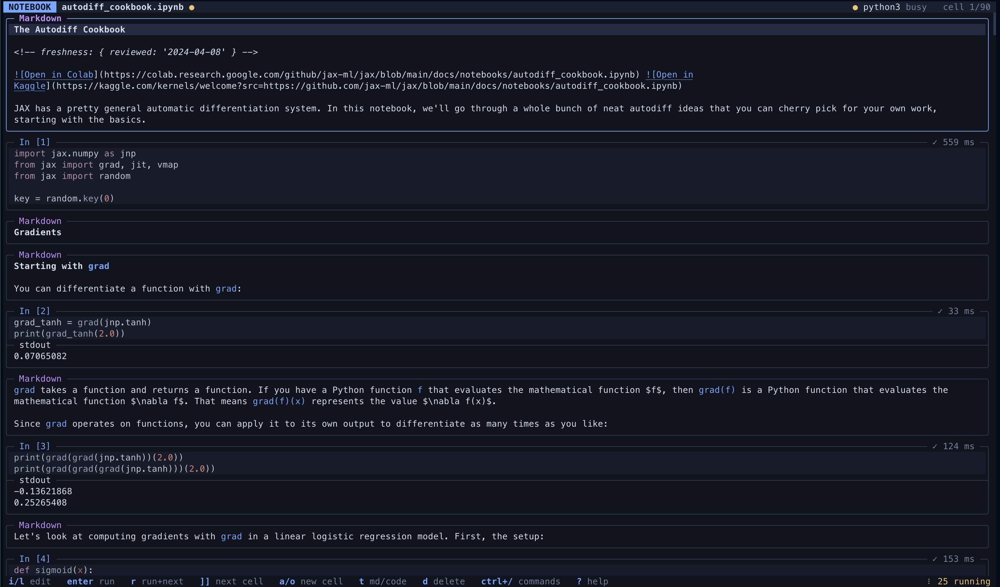

# nb



Jupyter notebooks in the terminal, with vim motions.

## Install

You need a Rust toolchain, version 1.90 or newer (`rustup update`).

```sh
git clone <this repo> notebook && cd notebook
cargo install --path crates/notebook --locked
```

This puts `nb` in `~/.cargo/bin`. Run the same command again to update.

## Use

Each project's environment needs `ipykernel`, which provides the Python
kernel:

```sh
pixi add ipykernel
pixi shell
nb analysis.ipynb      # open or create a notebook
nb quick_test.py       # percent-format script: cells start with `# %%`
```

`pixi run nb analysis.ipynb` also works, as does any conda or venv
environment with `ipykernel` installed.

Inside: `?` lists keys, `Ctrl+/` searches commands and settings, and
`:w`, `:wq`, `:q!` work as in vim. `nb --help` lists the command-line
options.

## Controls

Keys trigger actions; rules decide what an action does in a given mode and
on a given target; a rule's steps can switch modes. All of it is
configurable: the Controls tab of the settings screen (`:settings`, or
`Ctrl+,` in terminals that can send it) shows, for
each mode, what every key does there, and lets you rebind keys, turn rules
on and off, and open a rule in `$EDITOR`. `:explain <keys>` shows what keys
would do where the cursor is. The defaults, in the same format as your
`config.toml`, are in
[`crates/nb-tui/assets/default_controls.toml`](crates/nb-tui/assets/default_controls.toml).

`pixi run --manifest-path tests/live/pixi.toml live` checks every default
binding in a running `nb`: real keys through tmux, a real kernel, and
expectations written from vim semantics (`tests/live/cases.py`).
